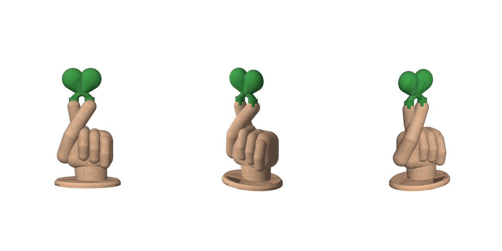

# Сердечко из пальцев (finger heart) — модель для 3D-печати

| Файл | Что это | Цвет |
|---|---|---|
| `hand.stl` | Кисть на подставке, 68×52×87 мм, в кончиках большого и указательного пальцев — отверстия Ø3.5×7 мм | телесный |
| `heart.stl` | Сердечко 40×38 мм с двумя ножками: чашечки обнимают кончики пальцев, штыри Ø3×6 мм входят в отверстия. Уже уложено для печати на плоскую спину | зелёный |
| `assembly.3mf` | Сборка с цветами (для просмотра / многоцветной печати) | — |
| `build.py` | Параметрический генератор (`pip install manifold3d trimesh numpy networkx lxml && python3 build.py`) | — |

## Печать
- **Рука**: стоя на подставке, слой 0.12–0.16 мм, заполнение 15 %, **древовидные поддержки** (под большим пальцем и согнутыми пальцами).
- **Сердечко**: лицом вверх, плоской спиной на стол — поддержки только под штырями/чашечками (или вовсе без них при хорошем охлаждении). Заполнение 20–30 %, 3 периметра — чтобы штыри были прочными.

## Сборка
Вставить оба штыря сердечка сверху в отверстия пальцев. Посадка с зазором 0.25 мм — для фиксации капля клея (суперклей / UHU). Если сидит туго или болтается — поменяйте `HOLE_R` в `build.py` и перегенерируйте.
